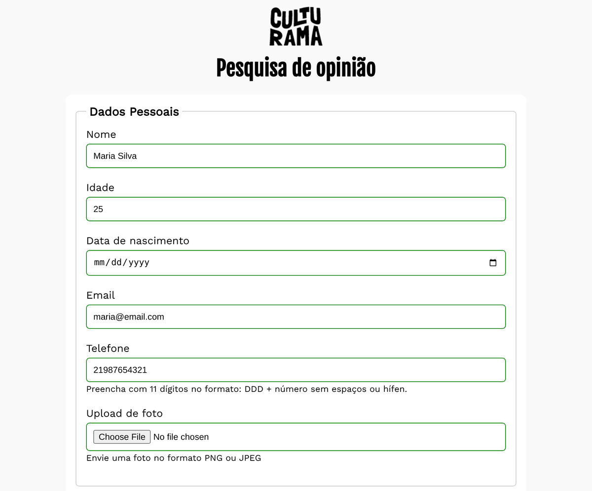

<div align="center">
  

  # Pesquisa Culturama

  Formulário de pesquisa de opinião feito com **HTML semântico** e **CSS puro**, com foco em validação nativa e acessibilidade.

  
  

  ### 🔗 [Ver projeto online](https://felipeoc12.github.io/pesquisa-culturama/)

  
</div>

---

## 📋 Sobre o projeto

A **Culturama** precisava de uma pesquisa para conhecer melhor o seu público. Este projeto é o formulário dessa pesquisa: ele coleta dados pessoais, perfil, hábitos e a opinião do usuário sobre o serviço e, ao enviar, leva para uma página de confirmação.

Todo o projeto foi feito **sem JavaScript**: a validação dos campos usa apenas os recursos nativos do HTML5.

## ✨ Funcionalidades

O formulário é dividido em 5 seções (`<fieldset>`):

| Seção | Campos |
| --- | --- |
| **Dados pessoais** | Nome, idade, data de nascimento, e-mail, telefone e upload de foto |
| **Perfil** | Gênero, estado civil, estado e cidade |
| **Hábitos** | Redes sociais, estilo musical e cor favorita |
| **Opinião** | Avaliação do serviço e comentário livre |
| **Confirmações** | Aceite para participar da pesquisa e opção de receber o resultado por e-mail |

Ao clicar em **Enviar**, o usuário é levado para a página `sucesso.html`. O botão **Limpar** apaga todos os campos.

## 🧠 O que foi praticado

- **Tipos de input do HTML5:** `text`, `number`, `date`, `email`, `tel`, `file`, `radio`, `checkbox`, `color`
- **Validação nativa:** `required`, `min` / `max`, `pattern="[0-9]{11}"` no telefone e `accept="image/*"` no upload
- **Elementos de formulário:** `<select>`, `<datalist>` (sugestões de estilo musical) e `<textarea>`
- **Organização semântica:** `<main>`, `<header>`, `<section>`, `<fieldset>` e `<legend>`
- **Acessibilidade:**
  - todo campo tem um `<label for>` ligado ao seu `id`
  - textos de ajuda ligados aos campos com `aria-describedby`
  - `aria-label` nos botões de enviar e limpar
  - `role="alert"` na mensagem de sucesso, para leitores de tela anunciarem a confirmação
- **CSS:** reset com `box-sizing: border-box`, layout centralizado com `max-width` e fontes do Google Fonts (*Fjalla One* e *Work Sans*)

## 📁 Estrutura

```
pesquisa-culturama/
├── css/
│   └── style.css          # estilos do formulário
├── img/
│   └── logo-culturama.png # logo do cabeçalho
├── culturama-favico.png   # favicon
├── index.html             # página do formulário
└── sucesso.html           # página de confirmação de envio
```

## 🚀 Como rodar

O jeito mais rápido é abrir a **[versão online](https://felipeoc12.github.io/pesquisa-culturama/)**, publicada com o GitHub Pages.

Para rodar na sua máquina, não precisa instalar nada:

```bash
# clone o repositório
git clone https://github.com/felipeoc12/pesquisa-culturama.git

# entre na pasta
cd pesquisa-culturama
```

Depois é só abrir o `index.html` no navegador, ou usar a extensão **Live Server** do VS Code.

> O formulário envia os dados com `method="get"`, então eles aparecem na URL da página `sucesso.html`. Não existe back-end: os dados não são salvos em lugar nenhum.

## 👤 Autor

Feito por **Felipe Corrêa**

[](https://www.linkedin.com/in/devfelipecorrea/)
[](https://github.com/felipeoc12)
